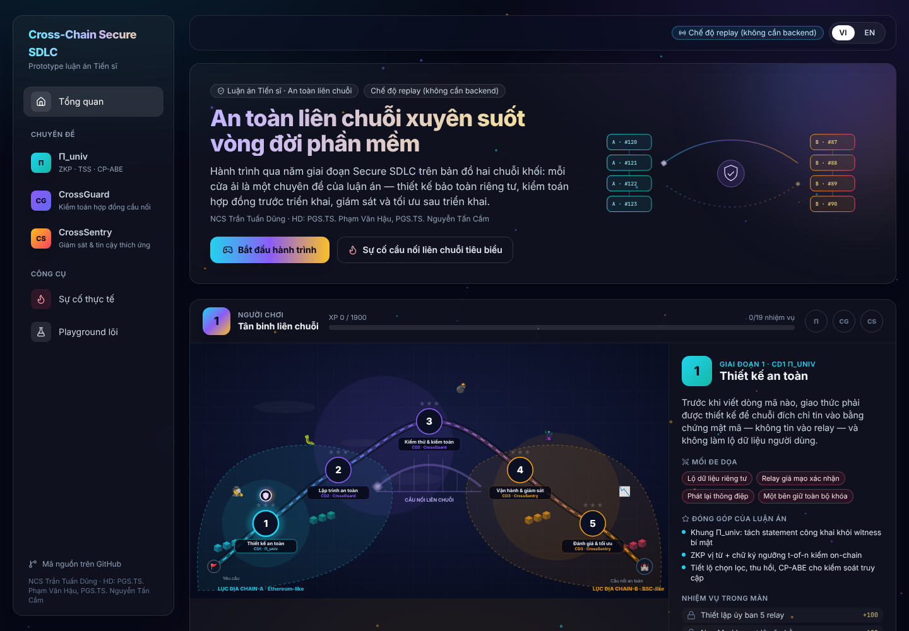
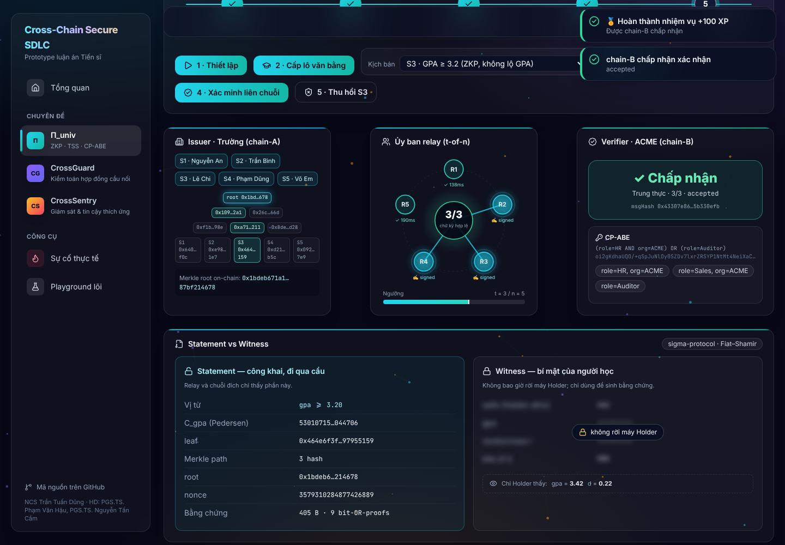
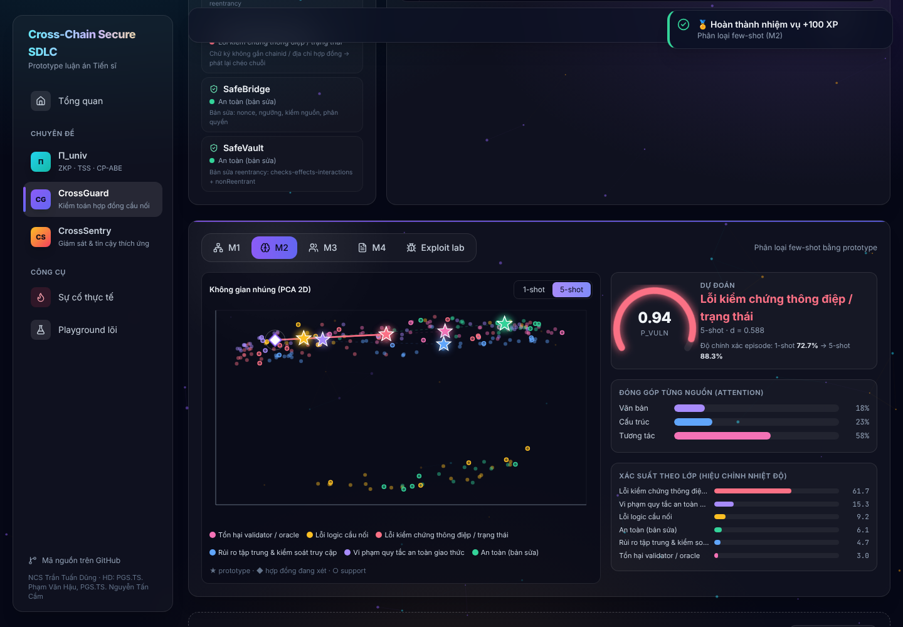
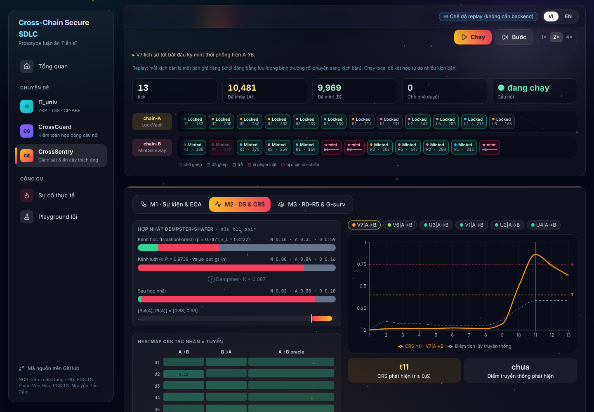
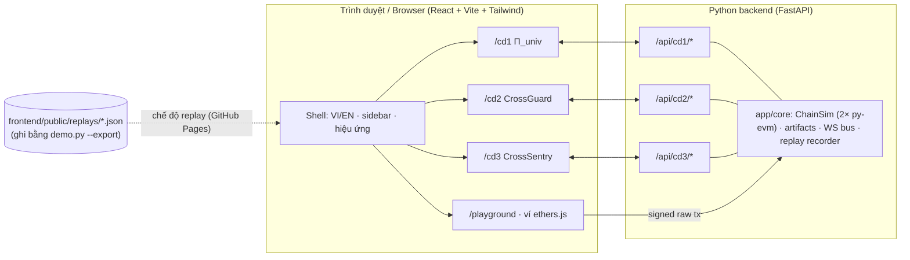

# Cross-Chain Secure SDLC — Thesis Prototype Demo

> **VI** · Prototype luận án Tiến sĩ về an toàn giao tiếp liên chuỗi theo khung Secure SDLC (3 chuyên đề) — NCS Trần Tuấn Dũng (HD: PGS.TS. Phạm Văn Hậu, PGS.TS. Nguyễn Tấn Cầm).
> **EN** · Browser demo of the PhD thesis on secure cross-chain communication across the Secure SDLC.

### 🌐 Demo trực tuyến / Live demo: **https://dungtran183.github.io/CrossChain-SDLC/**
Chạy hoàn toàn trên trình duyệt (chế độ replay, không cần cài đặt). Tự cập nhật mỗi khi push lên `main`.



---

## Trải nghiệm / Experience
- **Trang chủ = bản đồ thế giới kiểu game**: hai lục địa chain-A / chain-B nối bằng cây cầu; con đường Secure SDLC đi qua 5 cửa ải (Thiết kế → Lập trình → Kiểm thử & kiểm toán → Vận hành → Tối ưu). Bấm cửa ải để xem câu chuyện, mối đe dọa, đóng góp và nhiệm vụ; bấm "Vào màn chơi" để vào chuyên đề. Mỗi thao tác quan trọng là một nhiệm vụ (+100 XP), có cấp độ, sao và cúp cho từng chuyên đề.
- **Bức tranh tổng thể**: luận điểm, 3 câu hỏi nghiên cứu, vòng đời một thông điệp liên chuỗi với mối đe dọa ở từng chặng và chuyên đề phòng vệ, thẻ đóng góp + kết quả của từng chuyên đề.
- **Sự cố thực tế**: 9 vụ tấn công cầu nối tiêu biểu (Ronin, Wormhole, Nomad, Poly Network, BNB Bridge…) ánh xạ sang chuyên đề và màn demo tương ứng.

## Ba module độc lập / Three independent modules

| Module | Chuyên đề | Giai đoạn Secure SDLC | Demo làm được gì |
|---|---|---|---|
| **CĐ1 · Π_univ** | Tăng cường tính riêng tư trong giao tiếp liên chuỗi | 1. Secure Design | Văn bằng số liên chuỗi: cam kết Merkle neo trên chain-A · 5 kịch bản chứng minh (ZKP “GPA ≥ ngưỡng”, tiết lộ chọn lọc bằng cấp, vị từ kết hợp, khai gian, không thỏa) · ủy ban 5 relay ký ngưỡng 3-of-5 bằng ECDSA thật, chain-B kiểm `ecrecover` · 7 kiểu giả mạo bị từ chối on-chain (thiếu ngưỡng, chữ ký giả, signer trùng, proof sai, dùng sai ngữ cảnh, tráo cam kết, phát lại) · thu hồi · Shamir (t,n) · CP-ABE |
| **CĐ2 · CrossGuard** | Phát hiện lỗ hổng & kiểm toán hợp đồng thông minh liên chuỗi | 2–3. Secure Coding, Testing & Audit | 7 hợp đồng cầu nối lỗi (thêm reentrancy, thiếu domain separation) + 2 bản sửa · M1 đồ thị cấu trúc/token/thao tác liên chuỗi · M2 few-shot prototype (1-shot ↔ 5-shot) · M3 học liên kết DP-SGD 5 bên · M4 hồ sơ kiểm toán + bất biến có kiểu · **Exploit lab** chạy 7 tấn công thật trên EVM (phát lại, chữ ký trùng, nguồn giả, chiếm quyền, thao túng oracle, reentrancy, phát lại chéo chuỗi) (thành công trên bản lỗi, revert trên bản sửa) |
| **CĐ3 · CrossSentry** | Phát hiện bất thường & đánh giá tin cậy thích ứng | 4–5. Operations, Optimization | Cầu nối LockVault/MintGateway chạy theo tick với 18 tác nhân và 9 kịch bản (bình thường, slow-burn, thông đồng, phát lại, trì hoãn, nâng điểm, oracle lệch giá, rút cạn đột biến, mất validator) · ghép sự kiện 2 chuỗi + IsolationForest + ECA · hợp nhất Dempster–Shafer · CRS theo tác nhân–tuyến (so với điểm tích lũy truyền thống) · R0–R5 có **phê duyệt của con người** thi hành `blockActor`/`pause` on-chain · G-surv (Gini/Lorenz) và tối ưu F(Θ) |

Mỗi module chạy riêng, có trang riêng trên cùng một giao diện web; không có luồng tổng nối các module. Mỗi trang có nút **Trình chiếu** tự chạy kịch bản demo kèm phụ đề song ngữ (phím Space tạm dừng, → bước tiếp, Esc thoát) — xem [docs/DEMO_SCRIPT.md](docs/DEMO_SCRIPT.md).

| CĐ1 · Π_univ | CĐ2 · CrossGuard | CĐ3 · CrossSentry |
|---|---|---|
|  |  |  |



## Công nghệ / Stack
- **Blockchain giả lập**: 2 chuỗi EVM in-memory (`chain-A` id 31337, `chain-B` id 97) bằng `web3.py` + `eth-tester` (py-evm). 14 hợp đồng Solidity **thật** (`contracts/src/cd1|cd2|cd3`), biên dịch bằng npm `solc`, ABI/bytecode commit trong `contracts/artifacts/`. Giao dịch lỗi vẫn được đào thành block (status 0) kèm lý do revert để thấy trên explorer.
- **Backend**: Python 3.11+, FastAPI, numpy, scikit-learn, cryptography, eth-account.
- **Frontend**: React 18 + TypeScript + Vite + Tailwind, framer-motion (hiệu ứng), React Flow (`@xyflow/react`, đồ thị), Recharts (biểu đồ), ethers v6 (ví trình duyệt), lucide-react (icon).
- **Hai chế độ**: *live* (có backend, tính toán thật) và *replay* (phát lại các phản hồi API đã ghi — giao diện giống hệt, không cần backend, dùng cho GitHub Pages).

## Chạy / Run

### 1. Local — chế độ live (khuyến nghị khi trình bày)
Cần Python 3.11+ và Node 20+.

Linux / macOS:
```bash
bash scripts/setup_local.sh
```
```bash
bash scripts/dev.sh
```
Windows (PowerShell):
```powershell
./scripts/setup_local.ps1
./scripts/dev.ps1
```
Mở http://localhost:5173 (frontend dev) — backend tại http://localhost:8000/api/health, tài liệu API tại http://localhost:8000/docs.

**Một cổng duy nhất** (không cần Vite dev server): build frontend rồi để backend phục vụ luôn giao diện:
```bash
cd frontend && npm run build
```
```bash
cd backend && python -m uvicorn app.main:app --port 8000
```
Mở http://localhost:8000 (đặt `SERVE_FRONTEND=0` để tắt).

### 2. Local — chế độ replay (không cần Python)
```bash
cd frontend && npm run build:replay && npx vite preview
```

### 3. GitHub Pages (replay, công khai) — https://dungtran183.github.io/CrossChain-SDLC/
Workflow `.github/workflows/pages.yml` build chế độ replay với `VITE_BASE=/<tên-repo>/` mỗi khi push lên `main` và đẩy bản build lên nhánh `gh-pages`.
Nếu trang chưa hiện: **Settings → Pages → Build and deployment → Source: Deploy from a branch → `gh-pages` / `(root)`** (chỉ cần một lần).

### Tái sinh kịch bản replay
Sau khi sửa logic module, ghi lại các phản hồi API thật để Pages hiển thị đúng:
```bash
bash scripts/export_replays.sh
```
(Windows: `./scripts/export_replays.ps1`.) Mỗi module cũng có CLI riêng: `cd backend && python -m app.modules.cd1_univ.demo` (thêm `--export` để ghi JSON).

### Kiểm thử
```bash
python scripts/check_env.py
```
```bash
cd backend && python -m pytest -q
```
```bash
cd frontend && npm run build
```
```bash
cd contracts && npm run compile
```

## Tài liệu / Docs
- [docs/DEMO_SCRIPT.md](docs/DEMO_SCRIPT.md) — kịch bản trình bày 3–5 phút mỗi module (VI + EN).
- [docs/ARCHITECTURE.md](docs/ARCHITECTURE.md) — ranh giới module, API, live/replay.
- [docs/modules/CD1.md](docs/modules/CD1.md) · [CD2.md](docs/modules/CD2.md) · [CD3.md](docs/modules/CD3.md) — đặc tả từng module.

## Công bố liên quan / Related publications
- CĐ1: DAVE-CC (JISA 2025), Lotus (ISCIT 2025), CrossCert (2024), Medichain (2024), Zk-auction (ICIIT 2024).
- CĐ2: CrossGuard (Cluster Computing 2026), FedVuln (FGCS 2026), ChainSniper (ICIIT 2024).
- CĐ3: CrossTrust-IoT (IEEE IoT-J 2026), ChronosRep (Information Sciences 2026), BridgeGraph, CrossTaint (ICPADS 2026).
