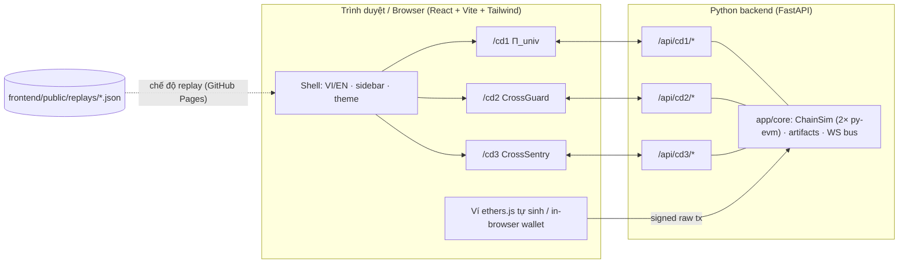

# Cross-Chain Secure SDLC — Thesis Prototype Demo

> **VI** · Prototype minh họa luận án Tiến sĩ về an toàn giao tiếp liên chuỗi theo khung Secure SDLC (3 chuyên đề) — NCS Trần Tuấn Dũng (HD: PGS.TS. Phạm Văn Hậu, PGS.TS. Nguyễn Tấn Cầm).
> **EN** · Browser demo of the PhD thesis on secure cross-chain communication across the Secure SDLC.

⚠️ **Đây là prototype trình diễn tính năng và workflow, KHÔNG tái lập số liệu của luận án.** Các module học máy chạy trên dữ liệu tổng hợp rất nhỏ; ZKP / TSS / CP-ABE là phiên bản *đồ chơi* (toy) để minh họa luồng xử lý.
⚠️ **This is a feature/workflow showcase, NOT a reproduction of the thesis results.** ML runs on tiny synthetic data; ZKP / TSS / CP-ABE are *toy* versions that illustrate the flow.

---

## Ba module độc lập / Three independent modules

| Module | Chuyên đề | Giai đoạn Secure SDLC | Nội dung demo |
|---|---|---|---|
| **CĐ1 · Π_univ** | Tăng cường tính riêng tư trong giao tiếp liên chuỗi | 1. Secure Design | Văn bằng số liên chuỗi: Merkle commitment, ZKP vị từ (toy), chữ ký ngưỡng t-of-n kiểm bằng `ecrecover` trên chuỗi đích, CP-ABE mô phỏng |
| **CĐ2 · CrossGuard** | Phát hiện lỗ hổng & kiểm toán hợp đồng thông minh liên chuỗi | 2–3. Secure Coding, Testing & Audit | M1 biểu diễn đa nguồn → M2 few-shot prototype → M3 học liên kết DP-SGD → M4 hồ sơ kiểm toán + bất biến; chạy thử tấn công phát lại trên EVM |
| **CĐ3 · CrossSentry** | Phát hiện bất thường & đánh giá tin cậy thích ứng | 4–5. Operations, Optimization | Ghép sự kiện 2 chuỗi + ECA → Dempster–Shafer + CRS theo tác nhân–tuyến → phản ứng R0–R5 có phê duyệt + G-surv (Gini) |

Mỗi module chạy riêng, có trang riêng trên cùng một giao diện web; không có luồng tổng nối các module.
Each module runs on its own page inside one web shell; there is no end-to-end pipeline coupling them.



## Công nghệ / Stack
- **Blockchain giả lập**: 2 chuỗi EVM in-memory (`chain-A` Ethereum-like, `chain-B` BSC-like) bằng `web3.py` + `eth-tester` (py-evm). Hợp đồng Solidity **thật**, biên dịch bằng npm `solc`, ABI/bytecode được commit trong `contracts/artifacts/`.
- **Backend**: Python 3.11+, FastAPI, numpy, scikit-learn.
- **Frontend**: React 18 + TypeScript + Vite + Tailwind + framer-motion (các phase sau: React Flow, Recharts, ethers.js).
- **Chế độ chạy**: *live* (có backend) và *replay* (JSON kịch bản, deploy GitHub Pages không cần backend).

## Bắt đầu nhanh / Quickstart (local)
Windows (PowerShell):
```powershell
./scripts/setup_local.ps1
./scripts/dev.ps1
```
Linux / macOS:
```bash
bash scripts/setup_local.sh
bash scripts/dev.sh
```
Mở http://localhost:5173 (frontend) — backend tại http://localhost:8000/api/health.

Kiểm tra môi trường: `python scripts/check_env.py`

## Tài liệu / Docs
- [docs/SETUP_GITHUB_CLOUD.md](docs/SETUP_GITHUB_CLOUD.md) — đẩy repo lên GitHub & dùng Claude Code cloud (từng bước).
- [docs/ROADMAP.md](docs/ROADMAP.md) — các phase, prompt cho từng phiên cloud, ngân sách credit.
- [docs/ARCHITECTURE.md](docs/ARCHITECTURE.md) — ranh giới module, API, live/replay.
- [docs/modules/CD1.md](docs/modules/CD1.md) · [CD2.md](docs/modules/CD2.md) · [CD3.md](docs/modules/CD3.md) — đặc tả từng module.

## Trạng thái / Status
- [x] Phase 0-init: khung repo, môi trường, tài liệu, kế hoạch
- [ ] P0 kiểm tra môi trường cloud · [ ] P1 lõi · [ ] P2 CĐ1 · [ ] P3 CĐ2 · [ ] P4 CĐ3 · [ ] P5 replay + Pages + polish

## Công bố liên quan / Related publications
- CĐ1: DAVE-CC (JISA 2025), Lotus (ISCIT 2025), CrossCert (2024), Medichain (2024), Zk-auction (ICIIT 2024).
- CĐ2: CrossGuard (Cluster Computing 2026), FedVuln (FGCS 2026), ChainSniper (ICIIT 2024).
- CĐ3: CrossTrust-IoT (IEEE IoT-J 2026), ChronosRep (Information Sciences 2026), BridgeGraph, CrossTaint (ICPADS 2026).
