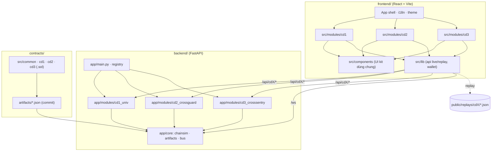

# Kiến trúc

## 1. Nguyên tắc
- **3 module rời, 1 giao diện.** Mỗi chuyên đề là một module tự chứa; shell web chỉ cung cấp điều hướng, i18n, theme và UI kit.
- **Không có pipeline tổng.** Không module nào gọi API hay import code của module khác.
- **EVM thật, chuỗi giả lập.** Hợp đồng Solidity chạy trên py-evm (eth-tester) — mỗi chuỗi là một `Web3` in-memory với chain-id riêng.
- **Live + Replay.** Mọi màn hình phải chạy được cả với backend (live) và với JSON tĩnh (replay, cho GitHub Pages).

## 2. Sơ đồ


## 3. Ranh giới thư mục theo module
| Module | Backend | Contracts | Frontend | Replay |
|---|---|---|---|---|
| CĐ1 Π_univ | `backend/app/modules/cd1_univ/` | `contracts/src/cd1/` | `frontend/src/modules/cd1/` | `frontend/public/replays/cd1/` |
| CĐ2 CrossGuard | `backend/app/modules/cd2_crossguard/` | `contracts/src/cd2/` | `frontend/src/modules/cd2/` | `frontend/public/replays/cd2/` |
| CĐ3 CrossSentry | `backend/app/modules/cd3_crosssentry/` | `contracts/src/cd3/` | `frontend/src/modules/cd3/` | `frontend/public/replays/cd3/` |

Cấu trúc gợi ý bên trong một module backend:
```
cdX_name/
├─ __init__.py      # MODULE metadata + export router
├─ router.py        # FastAPI APIRouter(prefix="/api/cdX")
├─ service.py       # trạng thái phiên demo của module (ChainSim riêng, dữ liệu, bước hiện tại)
├─ <thuật toán>.py  # vd zkp_toy.py, fewshot.py, dempster_shafer.py ...
├─ data/            # dữ liệu tổng hợp nhỏ / hợp đồng mẫu (nếu có)
└─ demo.py          # CLI: chạy kịch bản, --export ghi replay JSON
```

## 4. Hợp đồng API chung
Mọi module **bắt buộc** có:
| Method | Path | Ý nghĩa |
|---|---|---|
| GET | `/api/cdX/status` | `{module, status, phase, ...}` |
| POST | `/api/cdX/reset` | tạo lại ChainSim + dữ liệu của module |

Lõi (Phase P1):
| Method | Path | Ý nghĩa |
|---|---|---|
| GET | `/api/health` | `{status: "ok"}` |
| GET | `/api/modules` | danh sách metadata module |
| GET | `/api/chain/{name}/info` · `/blocks?limit=` | thông tin chuỗi, block gần nhất |
| POST | `/api/chain/{name}/faucet` | cấp ETH cho địa chỉ ví trình duyệt |
| POST | `/api/chain/{name}/send_raw` | gửi tx đã ký ở trình duyệt (kiểm chain-id trước) |
| WS | `/ws` | sự kiện `{type, source, data}`: `block`, `tx`, `log`, `module` |

> Từ P1, `/api/chain/*` thao tác trên một ChainSim "playground" của lõi; mỗi module có thể có route chain riêng dưới `/api/cdX/chain/*` nếu cần chuỗi độc lập.

## 5. Định dạng replay
`frontend/public/replays/<cdX>/<scenario>.json`:
```json
{
  "module": "cd2",
  "scenario": "replay-attack",
  "lang_neutral": true,
  "generated_by": "python -m app.modules.cd2_crossguard.demo --export",
  "steps": [
    { "t": 0, "kind": "state", "data": { } },
    { "t": 1, "kind": "event", "data": { } }
  ]
}
```
Frontend module đọc `steps` và phát lại bằng cùng component như chế độ live. Văn bản hiển thị không nằm trong replay (lấy từ i18n).

## 6. Chuỗi giả lập (ChainSim)
- `chain-A` (chain-id 31337, "Ethereum-like") và `chain-B` (chain-id 97, "BSC-like"); mỗi chuỗi 10 tài khoản có sẵn ETH.
- Mỗi giao dịch được đào ngay thành một block (auto-mine) — phù hợp để trực quan hóa từng bước.
- Relayer/validator là tiến trình Python trong module: đọc event chuỗi nguồn → ký → gọi hợp đồng chuỗi đích.
- Ví trình duyệt (ethers.js) chỉ ký; backend kiểm chain-id rồi gửi `eth_sendRawTransaction`.
- Biết trước: py-evm không tự từ chối tx sai chain-id → `send_raw` của lõi phải tự kiểm.

## 7. Chất lượng & giới hạn
- Backend: pytest cho từng module; mỗi API < ~3 giây.
- Frontend: `npm run build` (bao gồm `tsc --noEmit`) phải pass.
- Không lưu trạng thái lâu dài; reset module = trạng thái sạch.
